# Codeck 额度显示

ESP32-S3 / ESP-IDF 6.1 / LVGL 9.4。启动后连接 Wi-Fi，用 HTTP Basic Auth
获取 `/api/account`，显示 Codex 主额度窗口，默认每 60 秒刷新。

## 电脑模拟截图

以下截图于 **2026-10-06** 重新编译并运行主机测试后生成，覆盖设备的全部五个页面。
主机程序编译与固件共用的 `main/ui/ui_home.c`、`main/ui/ui_dashboard.c`、字体和
触摸输入代码，由真实 LVGL 在 **466 × 466** 的虚拟显示屏上绘制；测试模拟滑动和
点击，用 `lv_snapshot_take()` 导出 PPM，再无损转换为 PNG，保存在
[`docs/screenshots/`](docs/screenshots/)。这是离屏模拟，不会弹出可手动操作的桌面窗口。

### 五个页面

截图按设备左右滑动的顺序排列，点击图片可查看原始尺寸。

| 1. 首页 | 2. 额度详情 | 3. 成本统计 |
| --- | --- | --- |
| 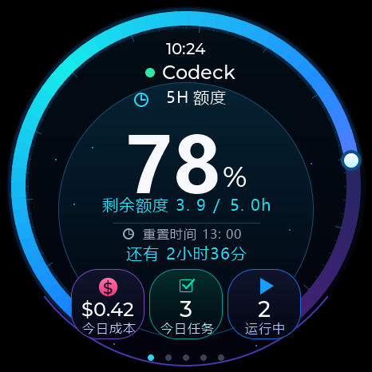 | 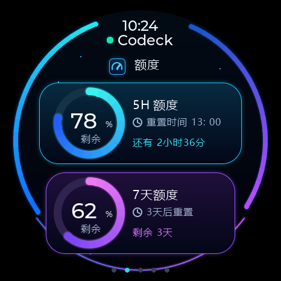 | 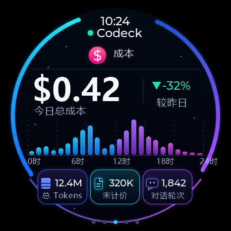 |
| 额度环、剩余小时数、重置倒计时，以及成本、今日任务、运行数量卡片。 | 同时查看主额度和周额度，显示各自的剩余比例与重置时间。 | 显示今日美元成本、较昨日变化、小时分布和用量统计。 |

| 4. 联网状态 | 5. 网络设置 |
| --- | --- |
| 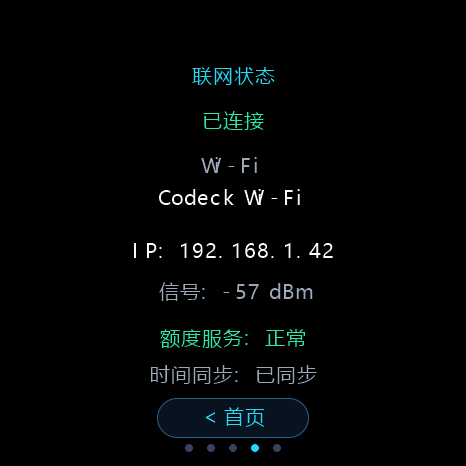 | 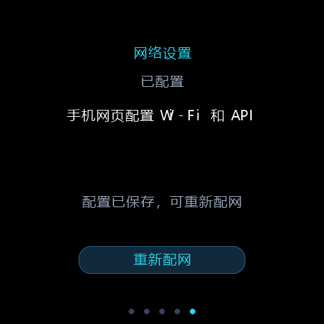 |
| 显示 Wi-Fi 名称、IPv4、信号强度、额度服务和时间同步状态；底部按钮返回首页。 | 查看配网状态，点击“重新配网”后先弹出确认框；配网期间可以完成或取消。 |

**截图数据说明：** 百分比、时间、SSID、IP、热点密码、成本与任务数量均由测试注入，
不是本次访问真实账户或网络得到的数据。首页的 `$0.42`、今日任务 `3`、运行中 `2`，
以及成本页的 `-32%`、`12.4M`、`320K`、`1,842` 和小时柱状图仅用于展示界面。
目前设备账号接口未映射成本、任务和运行数量，实际缺少数据时显示 `--` 或 `$--`。
网络与配网由 SDK 替身驱动；屏幕上的 `Codeck-1234` 和 `a1b2c3d4e5f6` 是固定测试值，
实际设备热点名与密码以设备屏幕为准。

### 等待数据与异常状态

<details>
<summary>首页：等待数据、95%、100% 和额度用尽</summary>

| 等待数据 | 剩余 95% |
| --- | --- |
| 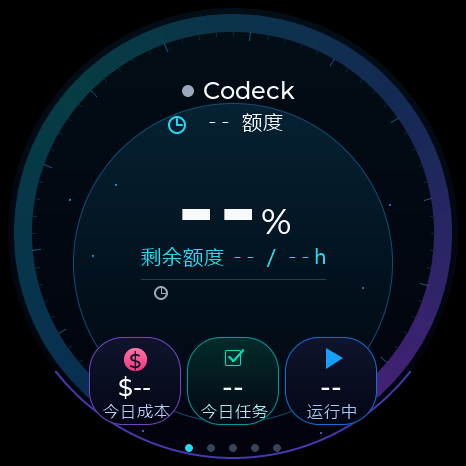 | 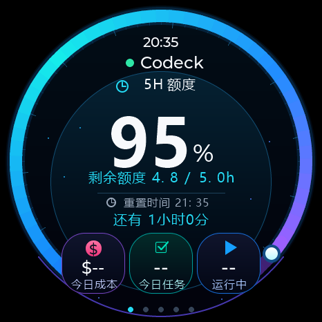 |

| 剩余 100% | 剩余 0%，请求失败 |
| --- | --- |
| 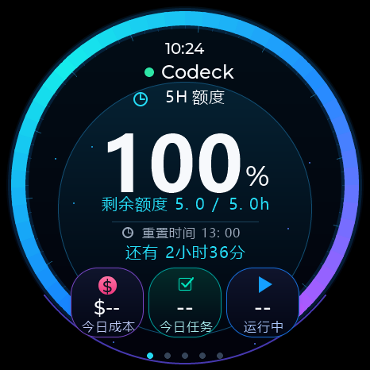 | 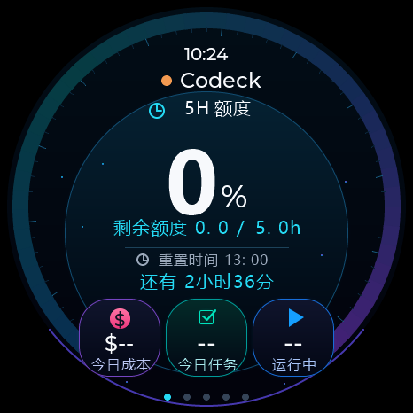 |

</details>

<details>
<summary>额度详情：周额度缺失、边界值和时间未同步</summary>

| 周额度缺失 | 主额度 0%、周额度 100% | 时间未同步 |
| --- | --- | --- |
| 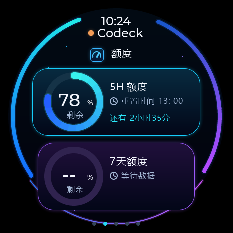 | 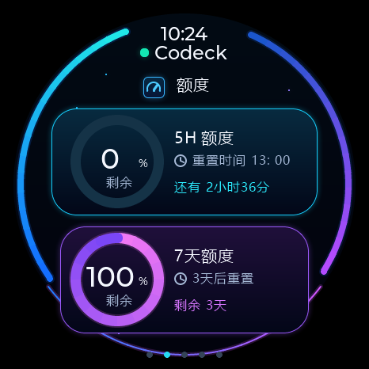 | 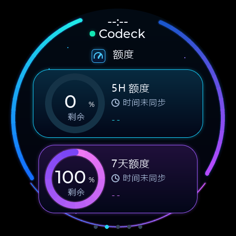 |

</details>

<details>
<summary>成本统计：无数据、成本上涨、非法值和有效零值</summary>

| 尚无成本数据 | 较昨日上涨 12% |
| --- | --- |
| 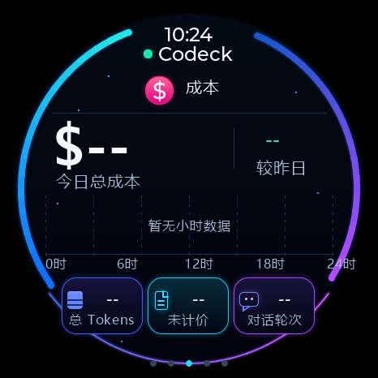 | 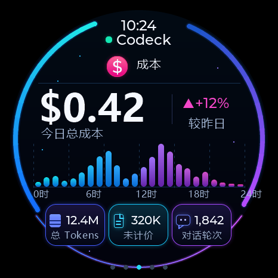 |

| 非法数据显示占位符 | 有效零值显示 $0.00 |
| --- | --- |
| 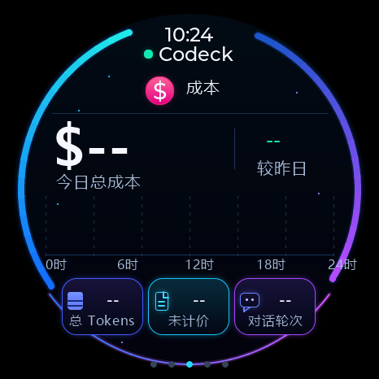 | 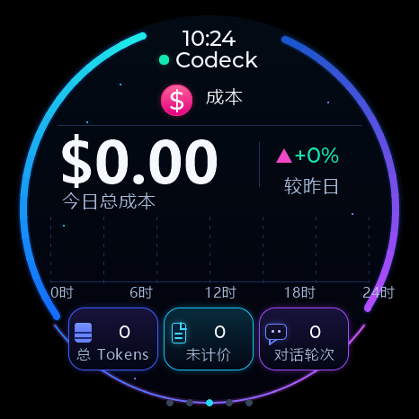 |

</details>

<details>
<summary>联网状态：已配置但断线、尚未配置</summary>

| 已配置但断线 | 尚未配置 |
| --- | --- |
| 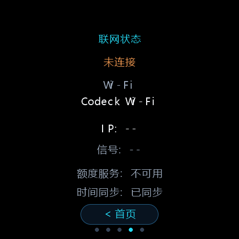 | 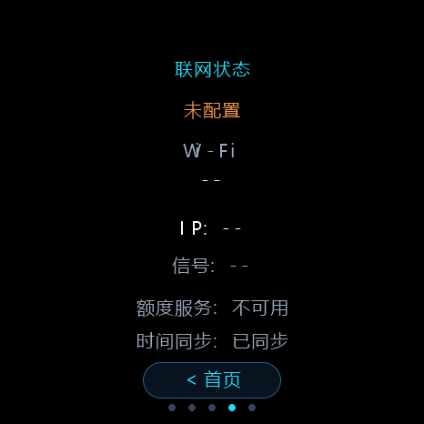 |

</details>

<details>
<summary>网络设置：确认、首次配网、连接、保存及失败等状态</summary>

| 重新配网确认框 | 等待手机配网 | 首次启动自动进入配网 |
| --- | --- | --- |
| 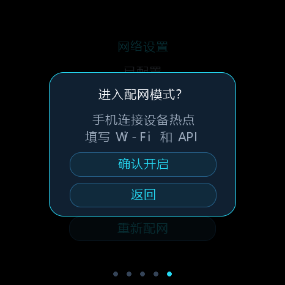 | 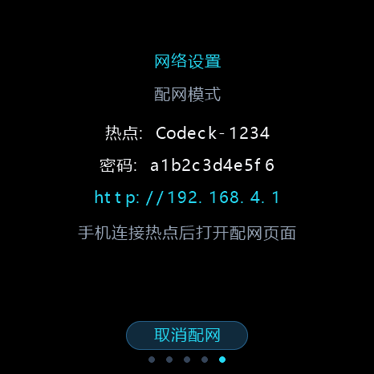 | 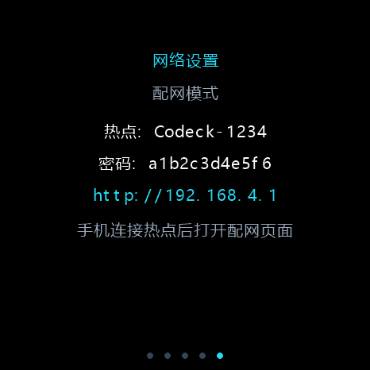 |

| 正在连接 Wi-Fi | 配置已保存，API 返回 401 | 正在关闭热点 |
| --- | --- | --- |
| 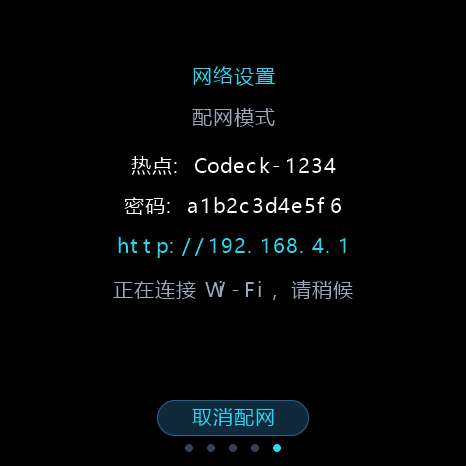 | 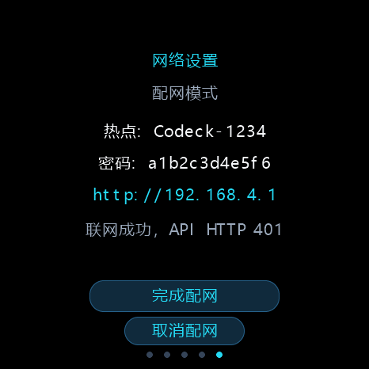 | 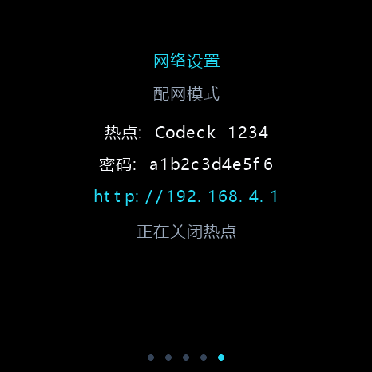 |

| Wi-Fi 连接超时 | 网络启动失败 |
| --- | --- |
| 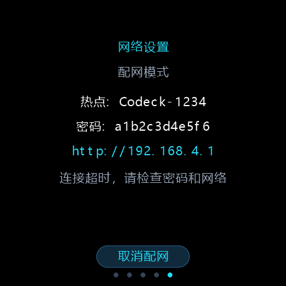 | 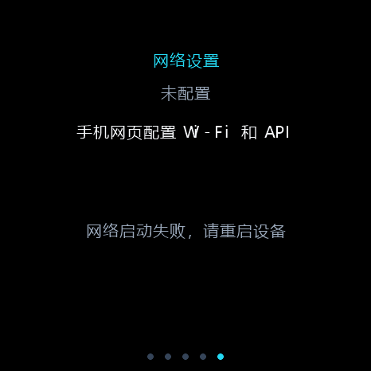 |

</details>

### 重新运行和生成截图

先完成一次 `idf.py build` 下载 `managed_components`，然后在安装了 C 编译器、
CMake 和 Python 3 的 Linux / WSL 终端进入项目根目录执行：

```sh
cmake -S tests/host -B build/host -DCMAKE_BUILD_TYPE=Debug
cmake --build build/host -j 8
ctest --test-dir build/host --output-on-failure
python3 tests/host/export_ui_screenshots.py
```

只需刷新截图时，构建后运行 UI 测试即可；必须从 `build/host` 运行，PPM 会写入当前目录：

```sh
(cd build/host && env -u CODECK_UI_HEAP_BYTES ./test_ui)
python3 tests/host/export_ui_screenshots.py
```

[`export_ui_screenshots.py`](tests/host/export_ui_screenshots.py) 只使用 Python 标准库，
将 26 张测试快照转换为 README 使用的 PNG，不需要安装图片处理库。
Windows 也可以在 WSL 生成 PPM 后运行 `python tests/host/export_ui_screenshots.py`。
设置 `CODECK_UI_HEAP_BYTES` 的设备堆预算测试会跳过截图，截图生成应使用普通 UI 测试。

本次重新构建后主机测试全部通过；截图用于检查字体、布局、颜色和状态展示。
真实 Wi-Fi、手机配网页面、HTTPS、屏幕驱动和触摸手感仍需按下文的实机验证步骤检查。

## 手机网页配置

固件不再读取 `main/config.local.h` 中的 Wi-Fi 和 API 凭据。升级后没有本版本的
NVS 配置时，自动进入第五页“网络设置”并开启 `Codeck-XXXX` 热点。

1. 手机连接屏幕显示的热点，输入屏幕上的独立热点密码。
2. 打开 `http://192.168.4.1`；支持自动弹出配网页面，未弹出时手动访问。
3. 扫描并选择 2.4 GHz Wi-Fi，或手动输入隐藏网络名称；填写 Wi-Fi 密码和
   API 地址、用户名、密码。开放网络密码留空，修改配置时可以保留已保存的密码。
4. 点击“连接并保存”。30 秒内取得 IP 后，整套配置写入 NVS，再验证额度接口。
   API 验证失败也保留配置，可在网页修改；点击“完成并关闭热点”退出配网。
5. 更换网络或账号时，滑到第五页“网络设置”点击“重新配网”，确认后再次用手机配置。
   网络设置页也支持完成配网和取消配网。

取消会恢复进入配网前的整套配置，包括已经保存的新配置；首次配置取消后回到
未配置状态，可以重新开始。普通断网只重连，不删除配置或自动开放热点。
进入配网时暂停旧网络的重连，避免影响扫描；关闭热点期间拒绝新提交。
API 验证超过 30 秒时显示超时，仍可完成已经保存的配置；SNTP 或额度任务失败
不会阻止网络设置界面运行。网络初始化失败会在屏幕提示重启，不自动擦除 NVS。
配置保存后断电重启仍有效。热点密码每次开机随机生成，
配置网页和 DNS 服务仅在配网期间开启，HTTP 服务绑定热点接口。
HTTP 服务会等待热点网络接口就绪后再绑定，避免启动时误绑定到 STA 接口。

API 默认地址为 `http://codeck.wangj.de/api/account`，须可从设备所连网络访问；
设备上的 `localhost` 指设备自身。支持 HTTP 与 HTTPS，HTTPS 使用内置 CA
证书包校验服务端证书，需要设备先同步时间；不支持自签名证书的绕过校验。
网页密码使用 POST 提交，读取接口不返回密码，修改接口要求本次配网的会话令牌。

首次构建使用组件管理器下载依赖。在设备屏幕上，字体未覆盖的动态 SSID 字符
显示为 `?`；网页显示完整名称，实际连接始终使用原始 SSID。

在已激活的 ESP-IDF 6.1 终端运行：

```powershell
idf.py build
idf.py -p COM3 flash monitor
```

五页网络固件约 1.74 MiB，使用 `partitions.csv` 的 2 MiB 应用分区。
已有 `sdkconfig` 时，在 `idf.py menuconfig` 的 Partition Table 中选择 Custom
partition table CSV，文件设为 `partitions.csv`，再构建。NVS、PHY 和应用的
起始地址与旧分区一致；首次升级需使用 `idf.py flash` 一并烧录新分区表。
已有配置还需启用 `CONFIG_ESP_HTTP_CLIENT_ENABLE_BASIC_AUTH`，并将
`CONFIG_CJSON_NESTING_LIMIT` 设为 32，并启用 `CONFIG_MBEDTLS_CERTIFICATE_BUNDLE`
和 `CONFIG_MBEDTLS_CERTIFICATE_BUNDLE_DEFAULT_FULL`；新项目由 `sdkconfig.defaults` 默认启用。

## 数据和状态

- 已有配置默认显示首页，页面顺序为“首页 → 额度详情 → 成本统计 → 联网状态 → 网络设置”。
  左右滑动切换相邻页面，两端不循环；底部五个圆点标识当前页面。
  全屏横滑超过 28 像素即时切换，支持慢速和略带斜向的滑动；一次触摸只切换一次。
  联网页底部可点击“< 首页”直接返回首页。触摸每 10 ms 采样，并过滤短暂丢点。
  页面切换只重绘目标页，
  额度圆环和文字只在内容变化时更新。
- 联网页定期更新 Wi-Fi 名称、连接状态、IPv4 地址和信号强度（dBm），并显示
  额度服务、时间同步状态。Wi-Fi 连接独立于额度接口请求结果；断线时清空 IP
  和信号信息，保留配置的 Wi-Fi 名称。

- 使用 HTTP GET、`Codeck/1.0` User-Agent、10 秒传输超时，禁用自动重定向和认证重试。
- 要求 HTTP 200、`ok: true`；解析 `rate_limits.rateLimits.primary` 的
  `usedPercent`、`windowDurationMins`、`resetsAt`；第 2 页同时显示
  `secondary` 中窗口为 10080 分钟的 7 天额度。周额度缺失或无效时显示占位值，
  不影响有效主额度；请求失败保留上次有效的两个窗口。忽略账户个人信息。
- 显示剩余百分比，300 分钟显示 `5H`；JSON 正文上限为 64 KiB，支持分块接收。
- 获取 IP 后在下一轮调度请求，随后每 60 秒刷新；Wi-Fi 断线后以至少 5 秒间隔重连。
- SNTP 使用 `ntp.aliyun.com`，按北京时间显示时钟和重置时间，每秒更新倒计时。
  同步前隐藏时间；倒计时到零时等待服务器数据，不自动恢复额度。
- 状态灯绿色表示最近一次请求成功且 Wi-Fi 已连接；橙色表示断网或请求失败。
  请求失败保留最后有效额度；首次请求前显示占位符。
- 日志只记录请求状态，不输出认证凭据、个人信息或响应正文。

第 3 页提供今日美元成本、较昨日变化、24 小时柱状图和总 Tokens / 未计价 Tokens /
对话轮次卡片。数据源在持有 LVGL 锁时调用 `ui_home_update_cost()`，传入
`ui_cost_view_t`；各字段通过 `has_*` 标记可用性。当前 `/api/account` 尚未配置
成本字段映射，所以设备成本页默认显示占位值，零值显示为真实零值。
`$0.42`、`-32%`、`12.4M`、`320K` 和 `1,842` 仅为主机视觉测试数据。

## 验证

首页使用贴边蓝青紫渐变额度环、大号百分比、剩余额度小时数和三张状态卡片。
剩余小时数按窗口长度和剩余百分比估算。今日成本通过 `ui_home_update_cost()`
同时更新首页和成本页；今日任务及运行数量通过 `ui_home_update_activity()` 传入。
未提供数据时显示 `--`，有效零值显示 `0`，任务数量超过 999 显示 `999+`。
这些接口均需持有 LVGL 锁；当前账号接口未映射任务及运行数量。

在 Linux 或 WSL 中，完成一次 ESP-IDF 构建以下载依赖后运行：

```sh
cmake -S tests/host -B build/host -DCMAKE_BUILD_TYPE=Debug
cmake --build build/host -j 8
ctest --test-dir build/host --output-on-failure
```

测试覆盖额度映射、非法/缺失字段、分块及 64 KiB 上限、北京时间和倒计时、
运行时认证配置、401/重定向/超时、HTTPS 校验配置、错误数据保留、5 秒重连，
60 秒刷新调度，以及配置版本、提交失败、首次配网、30 秒连接超时、重复提交与取消恢复。
网页接口测试覆盖密码隐藏/保留、格式校验、会话令牌与来源校验、扫描和完成操作。
回归测试还覆盖安全热点启动顺序、关闭期间拒绝提交、同 SSID 的旧 IP 事件、
取消恢复时快速取得 IP、恢复保存失败时停止试连、API 验证截止时间、SNTP/额度任务失败，以及网页
连接期间锁定表单和丢弃旧的状态请求结果。
有 Node.js 时，CTest 也会运行内置网页脚本的表单交互测试；可单独执行
`node tests/host/test_provision_web.js`。
网络任务使用 SDK 替身；界面测试使用真实 LVGL，生成 `build/host/ui_*.ppm`，
并验证左右触摸滑动、联网/断线/未配置显示、接口失败与 Wi-Fi 状态独立，
以及五页边界、配网弹窗、双额度环、未同步 / 缺失周额度、成本变化方向、
非法 / 零成本和 1000 次更新不重新创建控件。
视觉稿样例截图为 `ui_quota_details.ppm` 和 `ui_cost.ppm`。

实机需另外验证：手机热点连接、自动弹页/手动访问、Wi-Fi 扫描、错误密码与换网、
重启后的配置加载、API 401 和真实 HTTPS 证书失败、SNTP、间隔刷新、断网重连，
以及联网期间触摸响应。主机测试不能替代射频、手机系统和真实服务端验证。

固定界面文案变化后，在 Windows 执行 `main/ui/font/generate_ui_home_font.ps1`
重新生成字体。脚本从界面和网络源码收集固定中文文案，不再依赖编译配置中的 SSID。
另外生成新页面的 16 像素字体和成本数字字体：

```powershell
./main/ui/font/generate_ui_home_font.ps1 -FontSize 16 -FontName ui_dashboard_zh_16
./main/ui/font/generate_ui_home_font.ps1 -FontSize 64 -FontName ui_cost_digits_64 -Symbols '$0123456789.,KM-' -Bold
./main/ui/font/generate_ui_home_font.ps1 -FontSize 96 -FontName ui_home_digits_96 -Symbols '0123456789-' -Bold
```

已有 `sdkconfig` 需启用 `CONFIG_LV_FONT_MONTSERRAT_20` 和
`CONFIG_LV_FONT_MONTSERRAT_36`，并将 `CONFIG_LV_MEM_SIZE_KILOBYTES` 设为 128。
新项目由 `sdkconfig.defaults` 启用。设备的 128 KiB LVGL 控件堆从 PSRAM 分配，
两个 40 行 DMA 绘图缓冲区留在内部 RAM，默认关闭软件旋转，避免显示初始化耗尽
内部内存。主机测试以 128 KiB 堆预算额外验证
五页滑动和 1000 次更新，绘制峰值约 84 KiB；不在设备上分配整屏截图缓冲。
